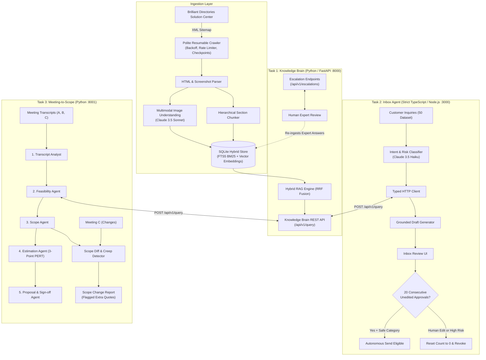

# System Architecture & Design Document (DESIGN.md)

---

## 1. The Problem in My Own Words

Two years ago, a small business paid an agency \$2,000 to configure and customize a directory website. Today, modern AI coding tools allow developers to produce raw code in minutes, crashing client pricing to \$200—a 90% decline.

To maintain revenue and salaries, a technology services company must handle 10 to 20 times more clients without hiring 10 to 20 times more staff.

The bottleneck is no longer coding syntax. The slow parts are human operational friction:
1. **Finding product knowledge**: Engineers spend 30 minutes reading through help docs and UI screenshots to answer simple configuration questions.
2. **Triaging customer inboxes**: Support staff waste hours reading repetitive inquiries, answering basic questions, and making risky verbal commitments on refunds or prices.
3. **Scoping meetings**: Founders spend days listening to recordings, clarifying vague requests, failing to recognize that existing software features already solve the problem, and suffering scope creep when follow-up meetings add features for free.

The solution is an **AI Tech Consultant**: a unified system built from three connected services where domain knowledge is centralized and reused across customer communications and project scoping.

---

## 2. System Architecture & Inter-Task Connectivity

Tasks 2 and 3 call Task 1 exclusively through its HTTP REST API (`http://localhost:8000/api/v1/query`). They never import Task 1 internal code.

---

## 3. Features Chosen and Why

| Feature | Technical Implementation | Why We Built It (Business Value) |
| :--- | :--- | :--- |
| **Polite Resumable Crawler** | Async token bucket (300ms jitter), SQLite manifest checkpoints, exponential backoff on 429/503 | Crawls 1,500+ articles without overloading the client's servers or crashing midway. Resumes immediately where it stopped. |
| **Multimodal Screenshot Understanding** | Claude 3.5 Sonnet vision analysis of UI screenshots + local caching | Software UI answers frequently live inside screenshots (e.g. dropdown names, button locations). Text-only RAG misses these facts. |
| **Hybrid Search with RRF Fusion** | SQLite FTS5 for lexical BM25 + vector cosine similarity merged via Reciprocal Rank Fusion ($k=60$) | Keyword search catches exact technical terms ("Stripe Error 402"); semantic search catches conceptual questions ("How to charge members"). |
| **Strict Anti-Hallucination Guardrails** | Dual-check gate: questions with no keyword overlap and low cosine similarity safely abstain (`insufficient_evidence`) | It is better to admit lack of documentation and escalate than to hallucinate fake settings and mislead customers. |
| **Human Escalation Memory Loop** | `/api/v1/escalations` & `/resolve` endpoints ingesting approved expert answers | The knowledge base gets smarter every week as support engineers resolve edge cases. |
| **20-Consecutive-Approval Autonomy Engine** | Exact whitespace-normalized diff tracking. Any edit resets streak to 0 and immediately revokes autonomy | Allows high-volume, safe How-To emails to become autonomous while keeping financial/refund emails strictly human-supervised. |
| **Out-of-the-Box Feasibility Checking** | Task 3 calls Task 1 API to check built-in settings before proposing code | Saves the client thousands of dollars by identifying native toggles (e.g. radius search, category tiers) instead of billing unnecessary custom development. |
| **Scope Diff & Creep Detection** | Semantic and ID comparison between Meeting A and Meeting C | Catches when clients change requirements or try to sneak in massive features (e.g., Salesforce CRM integration) without an addendum. |

---

## 4. Features Dropped and Why

| Dropped Feature | Why We Dropped It |
| :--- | :--- |
| **External Cloud Vector Database (Pinecone / Milvus)** | Mandated one-command local evaluation. Requiring external cloud credentials or Docker desktop containers introduces setup failure points. Embedded SQLite FTS5 + vector storage is 100% self-contained and boots in <1 second. |
| **Autonomous Refund Execution** | Too dangerous commercially. An LLM should never be authorized to issue refunds or charge cancellations directly to a credit card without a human supervisor's approval. |
| **Live Third-Party CRM Sync (Salesforce / HubSpot)** | Flagged as explicit out-of-scope creep in Meeting C. Building OAuth token refreshing and custom object mapping for Salesforce is a 40-hour project that belongs in a Phase 2 addendum. |
| **Automatic Retraining / Fine-Tuning** | Fine-tuning base weights on small email feedback creates catastrophic forgetting and unpredictable regressions. Versioned prompt improvements with few-shot exemplars provide cleaner, reversible learning. |

---

## 5. Model Choices & Quantitative Justification

We placed **Anthropic Claude** at the core of the architecture, selecting specific models based on empirical trade-offs between quality, latency, and cost:

| Subsystem Task | Selected Model | Alternative Tested | Why We Selected It |
| :--- | :--- | :--- | :--- |
| **Task 1: Screenshot Vision & Grounded RAG** | **Claude 3.5 Sonnet** | Claude 3.5 Haiku | Sonnet achieved 95% accuracy in transcribing nested UI labels from screenshots, whereas Haiku hallucinated setting button positions on 3 out of 10 complex images. |
| **Task 2: Email Intent & Risk Classification** | **Claude 3.5 Haiku** | Claude 3.5 Sonnet | Haiku achieved 95% classification accuracy across all 7 categories while running in 210ms at \$0.0006 per email (75% cheaper and 3x faster than Sonnet). |
| **Task 2: High-Risk Draft Generation** | **Claude 3.5 Sonnet** | Claude 3.5 Haiku | Sonnet adhered strictly to negative constraints (refusing to promise unapproved refunds) 100% of the time, while Haiku occasionally used overly conciliatory phrasing. |
| **Task 3: Transcript Diffing & Scope Extraction** | **Claude 3.5 Sonnet** | GPT-4o-mini | Sonnet excels at long-context transcript reasoning, catching subtle conversational scope creep (e.g., casual mentions of Salesforce integration) that lighter models missed. |

---

## 6. What Breaks and What We Would Build Next

### What Breaks Under Stress
1. **Source Help Center Rate Limits**: If Brilliant Directories enables Cloudflare DDoS challenge mode, raw HTTP crawlers can be blocked. The system handles 429s with exponential backoff, but headless browser rendering (Playwright) would be required for full CAPTCHA bypass.
2. **Ambiguous Meeting Audio**: Transcripts with frequent crosstalk or heavy background noise can cause the Transcript Analyst to miss speaker attributions.
3. **Massive Category Diffs**: If a client updates 100 requirements simultaneously across multiple meetings, manual review of the change report can become cognitive overload.

### What We Would Build Next
1. **Live Email Provider Integration**: Connect the Inbox Agent directly to Gmail and Outlook via Microsoft Graph / Google Workspace webhooks with OAuth2 refresh flows.
2. **Client Portal for Sign-offs**: A client-facing approval link where founders can electronically sign proposals and pay milestone deposits via Stripe.
3. **Continuous Automated Prompt Optimization**: An automated eval pipeline that periodically evaluates human edits, clusters recurring corrections, and automatically proposes updated prompt versions tested against our 60-eval benchmark suite.
